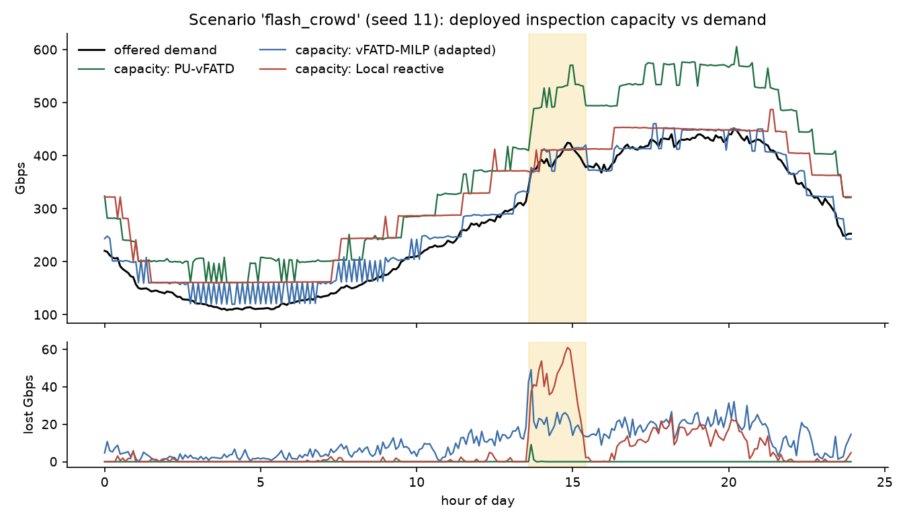
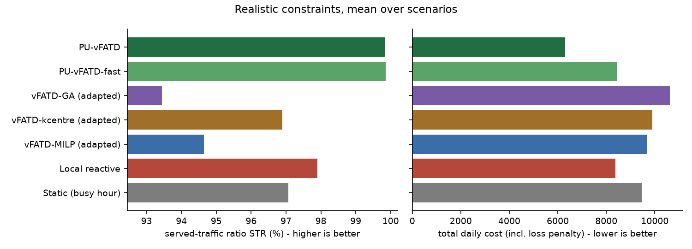
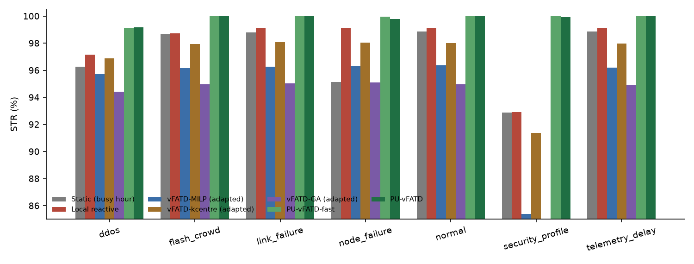
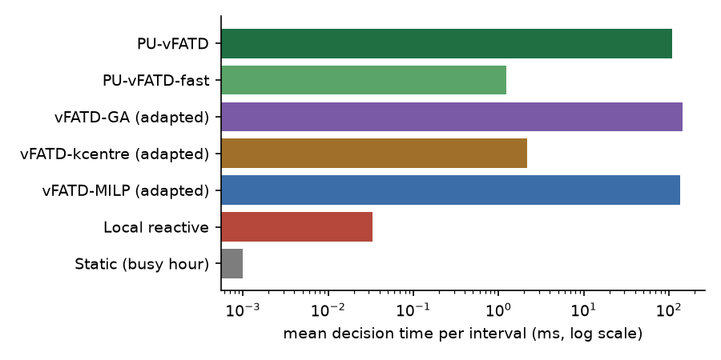

# PU-vFATD simulation results

Seeds per cell: 3 (11, 12, 13). Values are means; +/- is the 95% confidence half-width over seeds. **All traffic is synthetic** (daily cycle plus injected events); these are simulation results, not testbed measurements.

## Forecasting (Stage 2-3)

Coverage = share of intervals where the planning demand of Eq. (8) was at least the actual demand (target 1 - alpha = 0.95).

| forecaster | MAE (Gbps) | MAPE (%) | NLL (Eq. 5 as score) | coverage | mean reserve (Gbps) |
|---|---|---|---|---|---|
| persistence | 0.528 | 3.37 | -0.107 | 0.948 | 1.10 |
| seasonal_naive | 2.748 | 17.26 | 1.485 | 0.936 | 3.70 |
| seasonal_ratio | 0.551 | 3.50 | -0.082 | 0.946 | 1.14 |

## Comparison: Realistic constraints (links, latency, variable capacity, failures)

Mean over scenarios:

| method | STR | STR protected | daily cost | OPF | p95 latency (ms) | latency violations | RCF | lost (Gbps h) | decision (ms) | PICP |
|---|---|---|---|---|---|---|---|---|---|---|
| Static (busy hour) | 0.9706 | 0.9682 | 9456 | 1.76 | 7.91 | 0.0793 | 0.00 | 184.88 | 0.0 | - |
| Local reactive | 0.9790 | 0.9788 | 8384 | 1.21 | 6.10 | 0.0419 | 0.11 | 132.11 | 0.0 | - |
| vFATD-MILP (adapted) | 0.9464 | 0.9471 | 9663 | 1.04 | 9.65 | 0.1195 | 2.69 | 323.78 | 135.4 | - |
| vFATD-kcentre (adapted) | 0.9690 | 0.9648 | 9891 | 1.38 | 6.32 | 0.0430 | 5.33 | 189.94 | 2.2 | - |
| vFATD-GA (adapted) | 0.9344 | 0.9229 | 10618 | 1.07 | 8.23 | 0.1103 | 2.52 | 397.32 | 145.8 | - |
| PU-vFATD-fast | 0.9986 | 0.9995 | 8428 | 1.57 | 2.47 | 0.0007 | 0.21 | 9.06 | 1.2 | 0.946 |
| PU-vFATD | 0.9984 | 0.9992 | 6309 | 1.35 | 7.85 | 0.0050 | 1.08 | 10.46 | 108.8 | 0.946 |

Served-traffic ratio STR per scenario:

| method | ddos | flash_crowd | link_failure | node_failure | normal | security_profile | telemetry_delay |
|---|---|---|---|---|---|---|---|
| Static (busy hour) | 0.9626 +/- 0.0416 | 0.9865 +/- 0.0291 | 0.9879 +/- 0.0270 | 0.9513 +/- 0.0238 | 0.9886 +/- 0.0250 | 0.9289 +/- 0.0958 | 0.9886 +/- 0.0250 |
| Local reactive | 0.9714 +/- 0.0486 | 0.9873 +/- 0.0273 | 0.9913 +/- 0.0154 | 0.9913 +/- 0.0154 | 0.9913 +/- 0.0154 | 0.9290 +/- 0.0618 | 0.9913 +/- 0.0154 |
| vFATD-MILP (adapted) | 0.9572 +/- 0.0193 | 0.9616 +/- 0.0055 | 0.9628 +/- 0.0023 | 0.9634 +/- 0.0072 | 0.9638 +/- 0.0047 | 0.8540 +/- 0.0077 | 0.9620 +/- 0.0052 |
| vFATD-kcentre (adapted) | 0.9688 +/- 0.0325 | 0.9793 +/- 0.0087 | 0.9808 +/- 0.0044 | 0.9804 +/- 0.0121 | 0.9801 +/- 0.0056 | 0.9137 +/- 0.0307 | 0.9797 +/- 0.0083 |
| vFATD-GA (adapted) | 0.9442 +/- 0.0190 | 0.9496 +/- 0.0050 | 0.9502 +/- 0.0012 | 0.9511 +/- 0.0054 | 0.9498 +/- 0.0054 | 0.8473 +/- 0.0127 | 0.9491 +/- 0.0066 |
| PU-vFATD-fast | 0.9909 +/- 0.0343 | 0.9999 +/- 0.0004 | 1.0000 +/- 0.0000 | 0.9997 +/- 0.0005 | 1.0000 +/- 0.0000 | 0.9999 +/- 0.0005 | 1.0000 +/- 0.0000 |
| PU-vFATD | 0.9917 +/- 0.0328 | 0.9999 +/- 0.0002 | 1.0000 +/- 0.0002 | 0.9980 +/- 0.0011 | 1.0000 +/- 0.0000 | 0.9991 +/- 0.0009 | 1.0000 +/- 0.0000 |

Daily cost per scenario:

| method | ddos | flash_crowd | link_failure | node_failure | normal | security_profile | telemetry_delay |
|---|---|---|---|---|---|---|---|
| Static (busy hour) | 10132 +/- 4029 | 8317 +/- 2640 | 8178 +/- 2437 | 10681 +/- 2959 | 8126 +/- 2286 | 12630 +/- 8210 | 8126 +/- 2286 |
| Local reactive | 9027 +/- 4758 | 7799 +/- 3109 | 7437 +/- 2425 | 7437 +/- 2425 | 7437 +/- 2425 | 12114 +/- 6797 | 7437 +/- 2425 |
| vFATD-MILP (adapted) | 9079 +/- 2851 | 8614 +/- 1911 | 8443 +/- 1919 | 8412 +/- 1831 | 8361 +/- 1762 | 16243 +/- 4560 | 8490 +/- 1865 |
| vFATD-kcentre (adapted) | 10164 +/- 4553 | 9155 +/- 2527 | 8995 +/- 2328 | 8960 +/- 2715 | 9012 +/- 2343 | 13911 +/- 5453 | 9038 +/- 2526 |
| vFATD-GA (adapted) | 10136 +/- 3795 | 9580 +/- 3108 | 9410 +/- 2792 | 9371 +/- 2945 | 9451 +/- 2942 | 16931 +/- 5519 | 9448 +/- 3129 |
| PU-vFATD-fast | 9016 +/- 4071 | 8277 +/- 1748 | 8182 +/- 1781 | 8211 +/- 1821 | 8182 +/- 1781 | 8949 +/- 1872 | 8176 +/- 1790 |
| PU-vFATD | 6868 +/- 3517 | 6135 +/- 1555 | 6050 +/- 1539 | 6246 +/- 1675 | 6039 +/- 1548 | 6773 +/- 1756 | 6053 +/- 1562 |

Recovery time after the event (Eq. 45, minutes; 0 = never dropped below Gamma, - = not recovered within the day or no event):

| method | ddos | flash_crowd | link_failure | node_failure | normal | security_profile | telemetry_delay |
|---|---|---|---|---|---|---|---|
| Static (busy hour) | 188 | 68 | 188 | 270 | - | 577 | 120 |
| Local reactive | 183 | 60 | 210 | 163 | - | 195 | 163 |
| vFATD-MILP (adapted) | - | - | - | - | - | - | - |
| vFATD-kcentre (adapted) | 280 | 372 | 340 | 320 | - | - | 395 |
| vFATD-GA (adapted) | - | - | - | - | - | - | - |
| PU-vFATD-fast | 55 | 10 | 0 | 10 | - | 327 | 0 |
| PU-vFATD | 50 | 15 | 3 | 10 | - | 23 | 0 |

## Comparison: Original base-paper assumptions (over-provisioned network, fixed 50 Gbps)

Mean over scenarios:

| method | STR | STR protected | daily cost | OPF | p95 latency (ms) | latency violations | RCF | lost (Gbps h) | decision (ms) | PICP |
|---|---|---|---|---|---|---|---|---|---|---|
| Static (busy hour) | 0.9958 | 0.9958 | 6198 | 2.19 | 6.34 | 0.0623 | 0.00 | 27.96 | 0.0 | - |
| Local reactive | 0.9953 | 0.9954 | 7062 | 1.50 | 4.31 | 0.0047 | 0.11 | 31.09 | 0.0 | - |
| vFATD-MILP | 0.9996 | 0.9995 | 4011 | 1.27 | 6.85 | 0.1063 | 0.10 | 2.76 | 61.8 | - |
| vFATD-kcentre | 0.9995 | 0.9995 | 6969 | 1.42 | 5.42 | 0.0280 | 5.77 | 2.85 | 1.9 | - |
| vFATD-GA | 0.9995 | 0.9996 | 4059 | 1.27 | 7.44 | 0.0929 | 0.10 | 2.92 | 148.1 | - |
| PU-vFATD-fast | 0.9997 | 0.9997 | 7148 | 1.62 | 1.78 | 0.0002 | 0.23 | 1.81 | 0.6 | 0.947 |
| PU-vFATD | 0.9998 | 0.9998 | 4148 | 1.36 | 5.38 | 0.0714 | 0.14 | 1.48 | 61.6 | 0.947 |

Served-traffic ratio STR per scenario:

| method | ddos | flash_crowd | normal |
|---|---|---|---|
| Static (busy hour) | 0.9873 +/- 0.0353 | 1.0000 +/- 0.0000 | 1.0000 +/- 0.0000 |
| Local reactive | 0.9873 +/- 0.0471 | 0.9985 +/- 0.0058 | 0.9999 +/- 0.0003 |
| vFATD-MILP | 0.9989 +/- 0.0007 | 0.9999 +/- 0.0003 | 0.9999 +/- 0.0001 |
| vFATD-kcentre | 0.9988 +/- 0.0010 | 0.9998 +/- 0.0003 | 1.0000 +/- 0.0000 |
| vFATD-GA | 0.9990 +/- 0.0013 | 0.9998 +/- 0.0004 | 0.9999 +/- 0.0001 |
| PU-vFATD-fast | 0.9991 +/- 0.0016 | 1.0000 +/- 0.0001 | 1.0000 +/- 0.0000 |
| PU-vFATD | 0.9993 +/- 0.0009 | 1.0000 +/- 0.0001 | 1.0000 +/- 0.0000 |

Daily cost per scenario:

| method | ddos | flash_crowd | normal |
|---|---|---|---|
| Static (busy hour) | 6896 +/- 3040 | 5857 +/- 333 | 5841 +/- 330 |
| Local reactive | 7715 +/- 4185 | 6813 +/- 1307 | 6657 +/- 1144 |
| vFATD-MILP | 4115 +/- 1134 | 3985 +/- 1061 | 3932 +/- 1053 |
| vFATD-kcentre | 7072 +/- 1465 | 6950 +/- 1384 | 6886 +/- 1446 |
| vFATD-GA | 4159 +/- 1164 | 4041 +/- 1062 | 3977 +/- 1055 |
| PU-vFATD-fast | 7241 +/- 1485 | 7136 +/- 1439 | 7067 +/- 1453 |
| PU-vFATD | 4247 +/- 1212 | 4125 +/- 1091 | 4072 +/- 1104 |

Recovery time after the event (Eq. 45, minutes; 0 = never dropped below Gamma, - = not recovered within the day or no event):

| method | ddos | flash_crowd | normal |
|---|---|---|---|
| Static (busy hour) | 80 | 0 | - |
| Local reactive | 67 | 155 | - |
| vFATD-MILP | 10 | 7 | - |
| vFATD-kcentre | 10 | 10 | - |
| vFATD-GA | 10 | 12 | - |
| PU-vFATD-fast | 10 | 3 | - |
| PU-vFATD | 10 | 3 | - |

## Ablation study (realistic constraints)

Component ablations use the deterministic proposer so that each run changes one component only.

| variant | STR | STR protected | daily cost | OPF | lost (Gbps h) | RCF | PICP |
|---|---|---|---|---|---|---|---|
| fast proposer w/o SafetyGate | 0.9966 | 0.9977 | 8675 | 1.56 | 22.26 | 0.20 | 0.945 |
| PU-vFATD (full) | 0.9977 | 0.9990 | 6457 | 1.34 | 15.19 | 1.11 | 0.945 |
| w/o forecasting | 0.9973 | 0.9987 | 6419 | 1.26 | 17.30 | 1.69 | 0.489 |
| fixed capacity C0 | 0.9647 | 0.9665 | 8592 | 1.10 | 213.78 | 2.39 | 0.945 |
| migration/drain cost x3 | 0.9976 | 0.9990 | 6688 | 1.35 | 15.53 | 0.25 | 0.945 |
| fixed reserve (+15%) | 0.9972 | 0.9985 | 6605 | 1.43 | 18.63 | 0.54 | 0.998 |

## Safety layer (share of intervals per SafetyGate outcome, realistic comparison)

| method | accepted | repaired | projected | fallback: previous | fallback: vFATD | declared infeasible |
|---|---|---|---|---|---|---|
| PU-vFATD-fast | 0.969 | 0.023 | 0.000 | 0.000 | 0.000 | 0.008 |
| PU-vFATD | 0.996 | 0.000 | 0.000 | 0.000 | 0.000 | 0.004 |

## Figures

